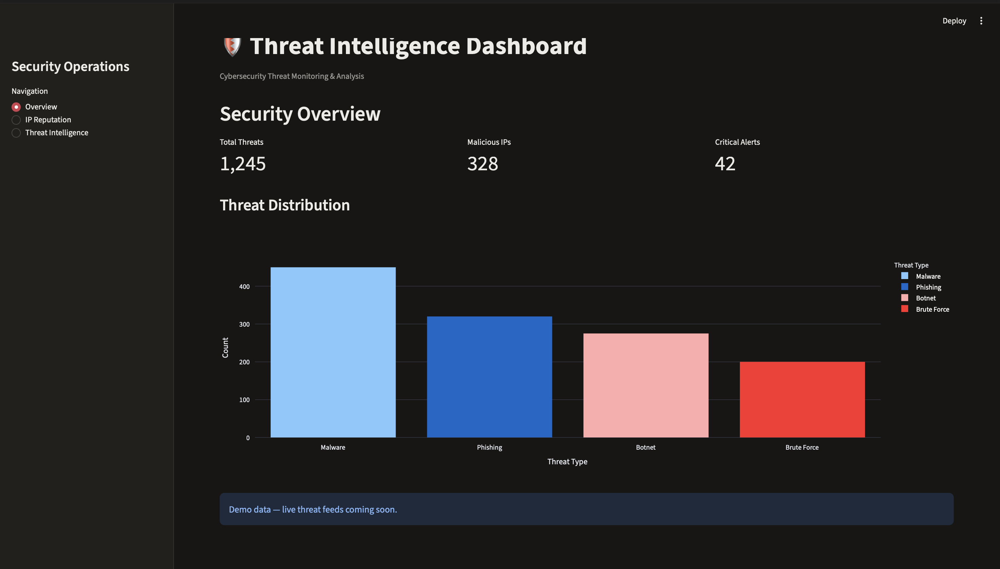

# 🛡️ Threat Intelligence Dashboard

## About This Project

I created this Threat Intelligence Dashboard as a personal cybersecurity project to practice working with threat intelligence, IP reputation, and security data.

The main goal of this project was to understand how security analysts collect and investigate suspicious IP addresses. I also wanted to get more experience working with Python, APIs, and data visualization.

## Features

### 1. Security Overview
- Displays sample security statistics and threat categories.
- Shows a bar chart of malware, phishing, botnet, and brute-force activity.
- Helps visualize different types of cybersecurity threats.

Note: The overview uses demo data, not real security alerts.

### 2. IP Reputation Checker
- Allows users to enter a public IP address.
- Uses the AbuseIPDB API to check reported abuse information.
- Displays the abuse confidence score and other IP details.
- Helps users investigate potentially suspicious IP addresses.

### 3. Live Threat Intelligence Feed
- Retrieves reported botnet IP addresses from Feodo Tracker.
- Displays the IP addresses in a table.
- Includes a refresh button to update the information.
- Uses publicly available threat intelligence data.

These IP addresses are reported threat indicators and do not necessarily represent active attacks.

## Technologies Used

- Python
- Streamlit
- Pandas
- Plotly
- Requests
- AbuseIPDB API
- Feodo Tracker

## How to Run the Project

### 1. Clone the repository

```bash
git clone https://github.com/mannamin715-droid/Threat-Intelligence-Dashboard.git
cd Threat-Intelligence-Dashboard
```

### 2. Install the required libraries

```bash
pip install -r requirements.txt
```

### 3. Configure the API key

Create a file named `secrets.toml` inside the `.streamlit` folder.

Add your AbuseIPDB API key using the configuration name expected by `app.py`.

Never upload your actual API key to GitHub
ABUSEIPDB_API_KEY = "YOUR_API_KEY_HERE".

### 4. Run the dashboard

```bash
python -m streamlit run app.py
```

Open the local URL displayed in Terminal.

## Project Screenshots

### Security Overview



### IP Reputation Checker


### Live Threat Intelligence Feed


## What I Learned

While working on this project, I learned how to connect Python applications with cybersecurity APIs and display the results in a dashboard.

I also learned how to work with threat intelligence feeds, investigate IP reputation scores, and use Pandas to organize security data.

One challenge I faced was handling the API responses and fixing Python errors while connecting the different parts of the dashboard. Solving those problems helped me improve my debugging skills.

Overall, this project gave me a better understanding of how threat intelligence can support security monitoring and investigations in a Security Operations Center (SOC).

## Future Improvements

In the future, I would like to add more threat intelligence sources, improve the dashboard's visualizations, and include additional information about suspicious IP addresses.

## Author

Mann Amin

Cyber Security Student | Temple University 


